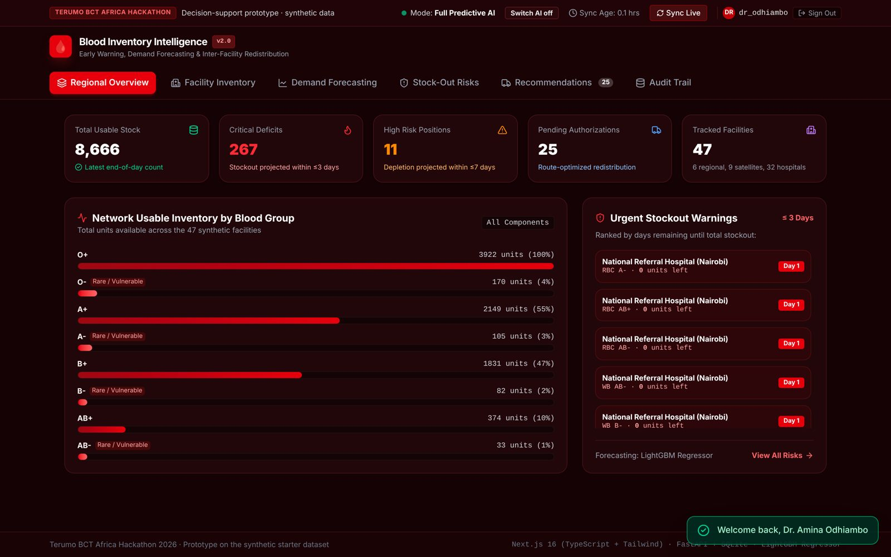
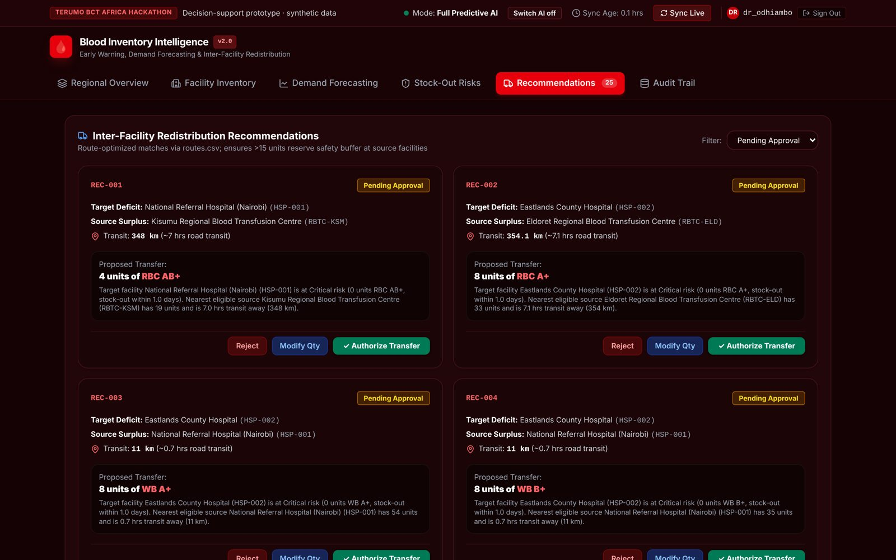
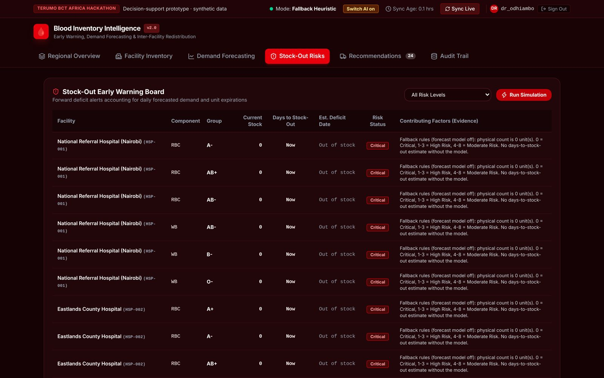
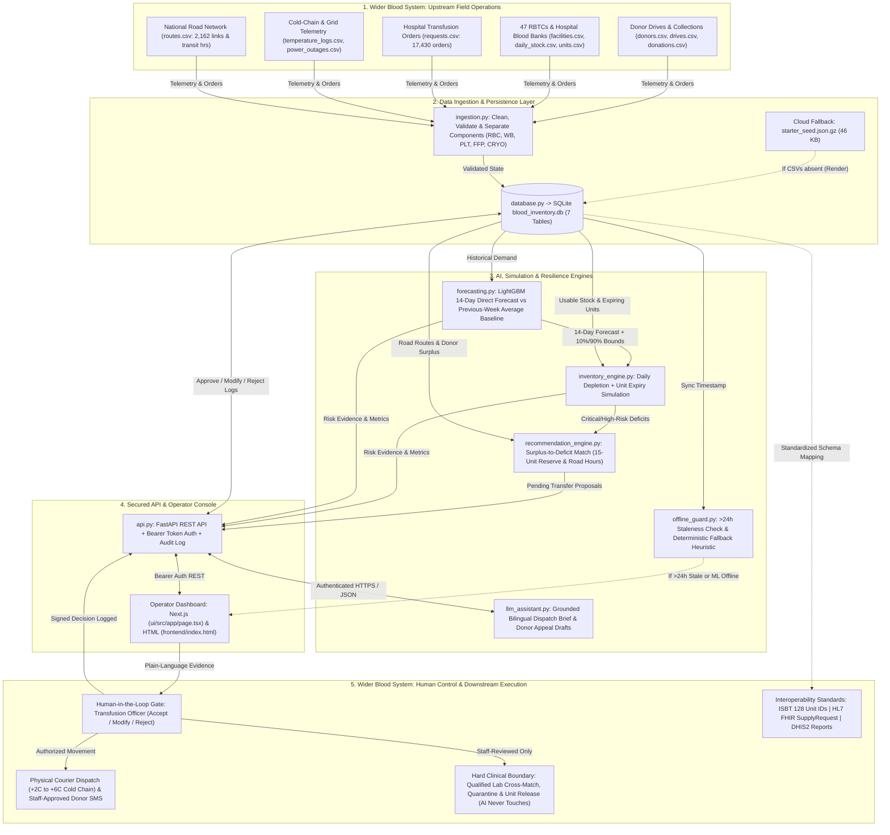
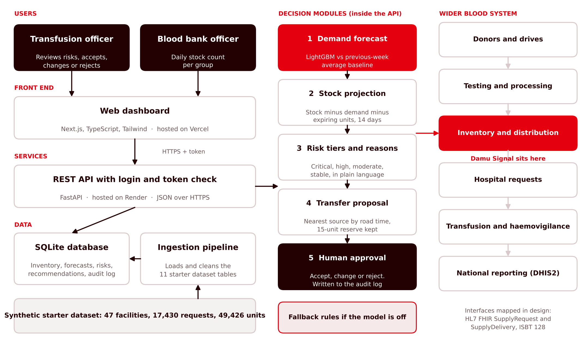

# Damu Signal: stock-out early warning and transfer recommendations for blood services

Terumo BCT Africa Hackathon 2026 · Challenge area: Stock-out early warning and forecasting

## The problem
**User:** a Regional Transfusion Officer at a regional blood transfusion centre (our persona is "Dr. Amina Odhiambo"), who supplies county hospitals 1 to 3 times a week. 

**Today:** she learns a hospital is out of a blood group when the hospital phones. An emergency resupply then takes a median of about 5 hours, longer for remote counties.

**How big it is, from the synthetic starter dataset (1 Nov 2025 to 31 Oct 2026):**
- 12.9% of the 17,430 hospital requests (34,242 units) were not fully met.
- For O negative patients, 47% of requests were not fully met. AB negative 34%, A negative 30%, B negative 24%.
- Hospitals had no red cells of any group on 23% of recorded hospital-days (2,466 of 10,585).
- About 23% of red cell and whole blood units were wasted (dataset README), while other sites ran short.
- About 6 in 10 donors are students, so collections fall in school holidays (November to early January, April, August).

These figures describe the synthetic dataset, not any real Kenyan facility.

## What we built
- **What works now:**
  - Demand forecast per facility and blood group for the next 14 days (LightGBM), with an uncertainty band on every prediction.
  - Forward stock projection per facility, component and blood group: current stock minus forecast demand minus units expiring (from `units.csv`), giving days to stock-out.
  - Risk tiers (Critical, High Risk, Moderate Risk, Stable) with the reasons in plain language, built from database fields only.
  - Transfer proposals: nearest source by road travel time (`routes.csv`), keeping a 15-unit reserve at the source.
  - A person in control: every proposal is Pending until an officer chooses **Authorize**, **Modify Qty** or **Reject** (reason required).
  - Audit log of every decision: who, when, old and new status, old and new quantity, and why.
  - **Switch AI off**: a button in the header (or `POST /api/stockout-risks/simulate?ai_offline=true`) drops the forecast and ranks risk from physical stock counts alone. The officer can still review and approve transfers.
  - English and Kiswahili dispatch notes and donor appeal drafts, filled from database fields by template. They are drafts for staff to approve. No large language model is called at runtime.
  - FastAPI REST API with token login, a Next.js dashboard, and 10 backend integration tests.
- **What is mocked or not finished:**
  - SMS and USSD alerts to couriers and donors (drafts are generated, nothing is sent).
  - Live fridge logger integration (cold chain is not part of this workflow yet).
  - Offline-first sync. The dashboard needs a connection to load. The staleness guard and fallback rules exist on the server.
  - One demo user. Role-based access for hospital and regional roles is not built.
  - Thresholds, shelf lives and the 15-unit reserve are constants in the code, not yet a settings table.

Demo video (3 minutes or less): https://drive.google.com/file/d/1k8oFinUFC9XB4kND7L10g6w4S2kaU8fX/view?usp=sharing  
Live demo: https://damusignal.vercel.app · Test log-in: dr_odhiambo / bloodbank2026





## How to run it
Tested on Linux and macOS with Python 3.11+ and Node 20+. About 5 minutes.

1. **Clone and install the backend**
   ```bash
   git clone https://github.com/Dox45/DamuSignal.git
   cd DamuSignal
   python3 -m venv .venv && source .venv/bin/activate      # Windows: .venv\Scripts\activate
   pip install -r requirements.txt
   ```
2. **Build the database and start the API**
   ```bash
   python gitcodes/ingestion.py                             # seeds SQLite from the embedded fixtures (no dataset download needed)
   uvicorn api:app --app-dir gitcodes --port 8000
   ```
   The API docs are at `http://localhost:8000/docs`. A lightweight dashboard is served at `http://localhost:8000/`.
3. **Start the Next.js dashboard** (second terminal)
   ```bash
   cd ui
   npm install -g pnpm      # only if pnpm is missing
   pnpm install && pnpm dev --port 3000
   ```
   Open `http://localhost:3000` and sign in with `dr_odhiambo` / `bloodbank2026`.
4. **Run the tests**
   ```bash
   python gitcodes/test_backend.py                          # 10 API and database tests
   ```
5. **(Optional) Retrain on the full starter dataset**: copy the 11 CSV files from the organisers' starter dataset into the repository root (or run `python starter_kit/gen.py` and copy `starter_kit/out/*.csv` to the root), then run `python gitcodes/ingestion.py` again. It retrains the model, prints baseline and model error, and rebuilds the risks and proposals. Then `python gitcodes/evaluate_simulation.py` prints the pipeline summary.

## Architecture

The diagram below shows the system's internal components, data flows, offline fallback path, and where our predictive decision-support workflow sits within the wider national blood transfusion system (preserving strict human control and clinical/laboratory boundaries).



The same picture as an image, with the wider blood system on the right: [`docs/architecture.png`](docs/architecture.png)



- **Data layer**: SQLite (`blood_inventory.db`) with 7 tables: facilities, inventory positions, demand forecasts, stock-out risks, recommendations, audit logs, system status.
- **Model layer**: LightGBM regressor (Tweedie objective) on lagged and rolling demand per facility and blood group, benchmarked against a previous-week moving average.
- **API**: FastAPI, 18 routes, Bearer token on every data route, CORS enabled.
- **User interface**: Next.js 16 (TypeScript, Tailwind CSS) dashboard on Vercel, plus a single-file HTML dashboard served by the API at `/` for slow connections.
- **Where it sits**: the inventory and distribution part of a blood-bank information system. It reads stock, requests, units and routes, and writes approved transfer orders. It does not release units, decide compatibility or touch laboratory results.
- **Standards (mapped in design, not implemented yet)**:
  - **HL7 FHIR**: an approved transfer maps to `SupplyRequest` and `SupplyDelivery`.
  - **ISBT 128**: unit identifiers would carry the ISBT 128 donation identification number.
  - **DHIS2**: monthly stock and stock-out aggregates would feed national indicators.

## AI and data
- **What the AI or data feature does:** forecasts daily blood demand per facility and blood group for the next 14 days. The forecast drives the days-to-stock-out projection and the risk tier.
- **Baseline we compared against:** the average of the previous week (a 7-day moving average).
- **Result** (synthetic starter dataset, model trained on data up to 3 Oct 2026, tested on the held-out 17 to 31 Oct 2026):

  | Measure | Baseline | Our model | Change |
  |---|---|---|---|
  | Mean absolute error, units per facility, group and **week** | 1.43 | 1.09 | 24% lower |
  | Weighted absolute percentage error, weekly | 78.4% | 59.7% | 18.7 points lower |
  | Mean absolute error, units per facility, group and **day** | 0.4676 | 0.4361 | 7% lower |

  Daily demand per facility and group is sparse (0.36 units a day on average), so percentage error at daily level is above 100% for both methods. Weekly totals are the level a manager plans at. Reproduce with `python gitcodes/forecasting.py` (it uses `requests.csv` if present, otherwise the embedded daily demand fixture built from it).
- **Uncertainty:** every prediction is stored with a lower and upper estimate (plus or minus 1.28 standard deviations of held-out error, roughly an 80% band) and shown on the forecast chart.
- **How a user sees the reason for a recommendation:** each risk row and each transfer proposal carries a sentence built from database fields: current stock, projected days to stock-out, 7-day demand, units expiring, source stock, road distance and hours.
- **Who approves it (Accept / Change / Reject):** the transfusion officer. Every proposal starts as `Pending Approval`. Nothing moves without a recorded decision.
- **What happens if the AI is wrong or offline:** the officer presses **Switch AI off**. Risks are then ranked by rules on the physical count (0 units Critical, 1 to 3 High Risk, 4 to 8 Moderate Risk), the header shows `Fallback Heuristic`, and the approval workflow carries on. The server also flags data older than 24 hours as stale.
- **What the AI never does:** it does not release units, decide compatibility, override laboratory results or contact anyone. Message drafts need staff approval.

## Pipeline output on the starter dataset
Measured by `python gitcodes/evaluate_simulation.py` on the latest stock snapshot (31 Oct 2026):
- 509 stock positions monitored across 47 facilities.
- 278 flagged Critical or High Risk (267 Critical, 11 High Risk). Most Critical rows are positions already at zero, which is too many alerts for a real user. Tuning this is the first item under known limits.
- 25 transfer proposals covering 169 units, on average 155 km and about 3.4 hours by road, with at least 15 units kept at every source.
- For flagged positions that still hold stock, the median warning before the projected stock-out is 4 days.

We have not yet replayed the proposals against held-out stock, so we make no claim about stock-outs prevented.

## Data
- Starter dataset tables read by the pipeline: `facilities.csv`, `requests.csv`, `daily_stock.csv`, `units.csv`, `routes.csv`. The other six tables are checked by `gitcodes/data_analysis.py` only.
- The raw CSVs are not committed. `gitcodes/fixtures/` holds compact aggregates built from them (daily demand, latest stock and expiring units, routes, and the seeded database snapshot) so the hosted demo and a fresh clone run without the dataset download.
- We match on `facility_id`, not the typed facility name (14% of request rows type it differently), and exclude requests with an unknown patient blood group from model training.
- Only the synthetic starter dataset is used. No real donor, patient or facility data.
- `starter_kit/` holds files provided by the organisers (dataset generator, data dictionary, landing page). They are not our code.

## African conditions
- **Power and connectivity:** the server flags data older than 24 hours and the fallback rules need only a physical count, so a site that cannot sync still gets a usable risk list. The API also serves a single-file HTML dashboard for slow links. Offline-first sync and SMS alerts are not built yet.
- **Roads, not straight lines:** sources are ranked by road travel hours from `routes.csv`.
- **Languages:** dispatch notes and donor appeal drafts are produced in English and Kiswahili.
- **Another site or country:** facilities, routes and stock come from data files, so a new network loads without code changes. Shelf lives, risk thresholds and the reserve are single constants today and would move to a settings table.
- **Existing systems:** approved transfers map to FHIR supply resources and stock summaries to DHIS2 (design only).

## AI tools we used
- **Antigravity AI** (Chima): code refactoring and test suite generation.

## Team
| Name | Role | Country | Presenting Friday (in person / online) |
|------|------|---------|-----------------------------------------|
| Chima Emmanuel | Lead developer and ML engineer: pipeline, API, dashboard, deployment | Nigeria | Online |
| Ayomide Agbaje | Data and insights lead: problem sizing, model evaluation, pitch and demo | Rwanda | Online |

## Known limits and next steps
- Too many positions are flagged Critical because every empty shelf counts, including components a site may not normally hold. Next: thresholds per facility and component, tuned with a blood service.
- The forecast splits demand across components with fixed shares. Next: forecast per component from `component_requested`.
- No replay of proposals against held-out stock yet, so impact is not measured.
- Offline-first app with a sync queue, and SMS alerts through a gateway such as Africa's Talking.
- Role-based access (hospital blood bank officer and regional officer) and a settings table per country.
- Cold chain: remove units exposed to temperature excursions from usable stock.
- Pilot with one regional blood transfusion centre and the hospitals it supplies.
